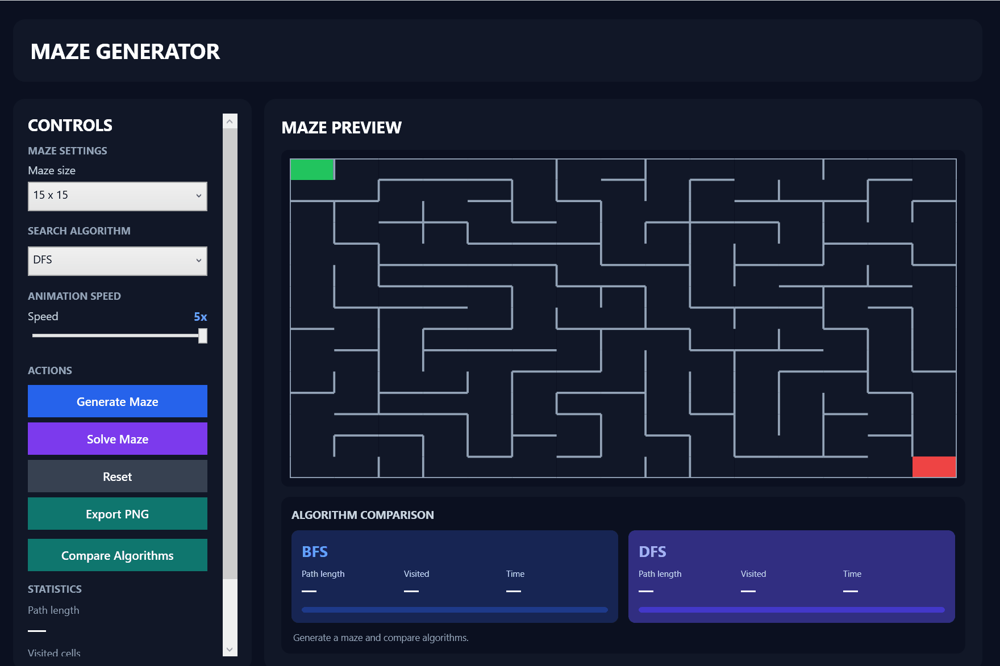
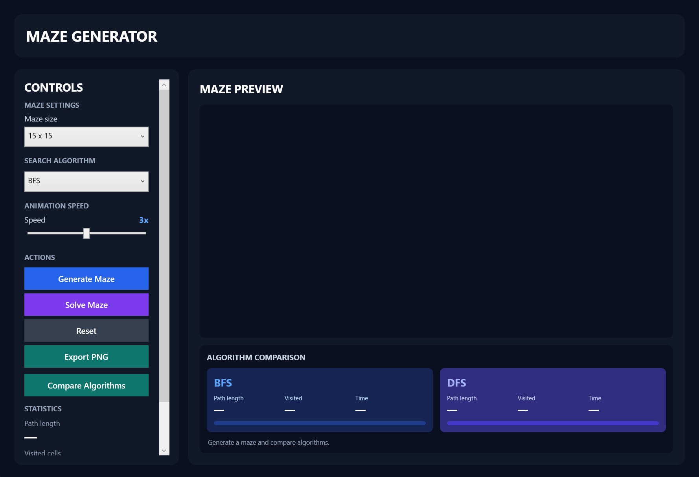
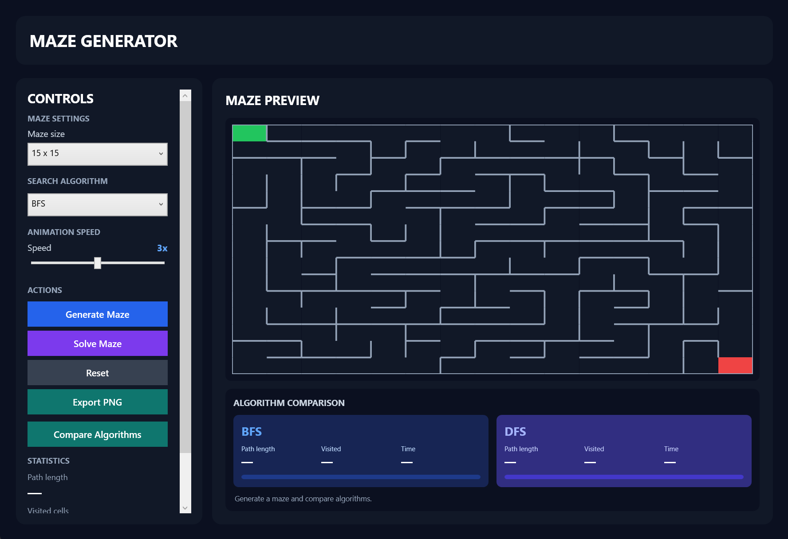
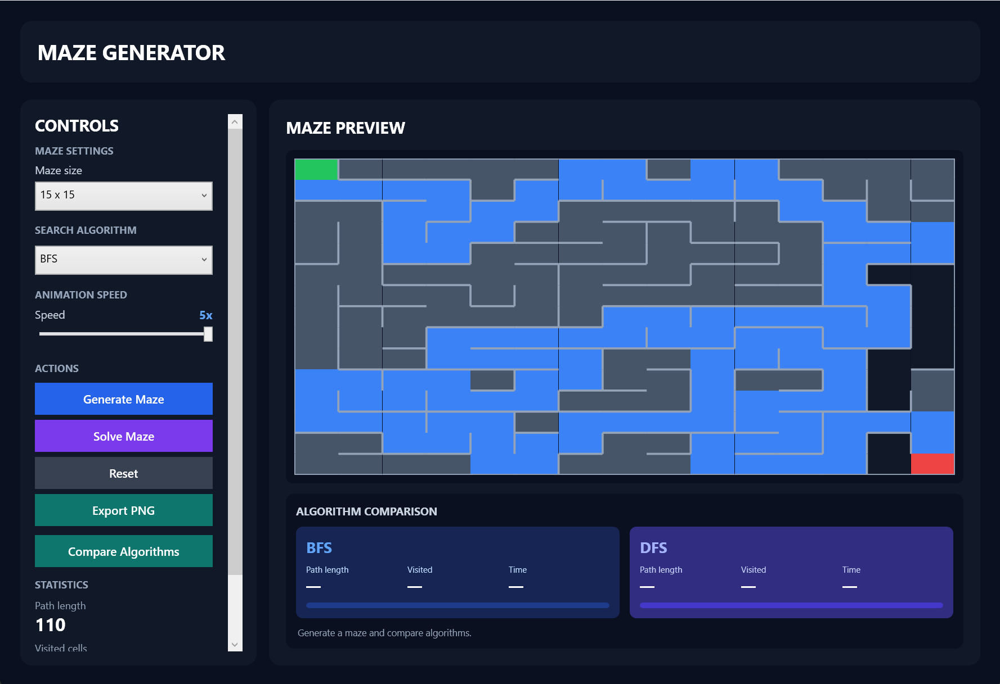
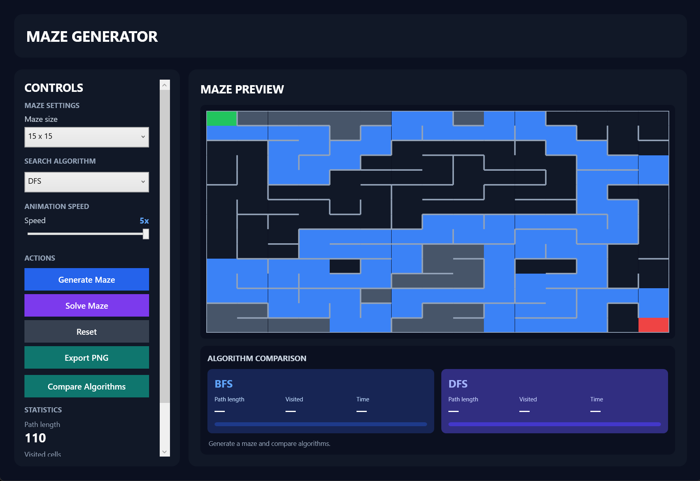
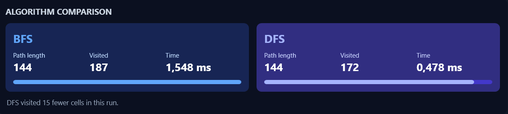

# maze-generator-solver
# Maze Generator and Solver

A desktop application built with C# and WPF that generates random mazes, visualizes pathfinding algorithms, and compares their performance.

## Demo



## Overview

Maze Generator and Solver is a programming practice project focused on maze generation, graph traversal, and pathfinding algorithms.

The application creates random mazes using Depth-First Search (DFS), allows users to solve them using Breadth-First Search (BFS) or DFS, and visualizes the entire process through animations.

## Features

- **Random Maze Generation** — automatically creates random mazes of different sizes.
- **Animated Generation** — visualizes how the maze is built using DFS.
- **BFS Pathfinding** — finds the shortest path from start to finish.
- **DFS Pathfinding** — explores the maze using depth-first search.
- **Animated Pathfinding** — displays visited cells and the final route.
- **Animation Speed Control** — adjustable speed from 1x to 5x.
- **Algorithm Comparison** — compares BFS and DFS by path length, visited cells, and execution time.
- **Statistics** — displays path length, visited cells, and execution time.
- **PNG Export** — saves the generated maze as a PNG image.
## Screenshots

### Main Window



### Maze Generation



### BFS Solution



### DFS Solution



### Algorithm Comparison




## Algorithms

### Maze Generation — Depth-First Search (DFS)

The application uses the Recursive Backtracker algorithm implemented with a stack.

The generator starts from the first cell, randomly selects an unvisited neighbor, removes the wall between the cells, and continues until all cells have been visited.

### Breadth-First Search (BFS)

BFS uses a queue to explore neighboring cells level by level.

It guarantees the shortest path in an unweighted maze.

### Depth-First Search (DFS)

DFS uses a stack to explore one direction as deeply as possible before backtracking.

Unlike BFS, DFS does not generally guarantee the shortest path.

## Technology Stack

- **Language:** C#
- **Framework:** .NET 10
- **Desktop Interface:** Windows Presentation Foundation (WPF)
- **Development Environment:** Visual Studio 2026
- **Image Export:** WPF Imaging API

## Project Structure

```text
MazeGeneratorSolver/
│
├── ALGORITHMS/
│   ├── MazeGenerator.cs
│   └── MazeSolver.cs
│
├── MODELS/
│   ├── Cell.cs
│   ├── Maze.cs
│   └── MazeStep.cs
│
├── SERVICES/
│   ├── MazeExportService.cs
│   └── MazeStatisticsService.cs
│
├── App.xaml
├── MainWindow.xaml
└── MainWindow.xaml.cs
```

### Main Components

| Component | Responsibility |
|---|---|
| MazeGenerator | Generates random mazes using DFS |
| MazeSolver | Implements BFS and DFS pathfinding |
| Cell | Represents an individual maze cell |
| Maze | Stores the maze grid |
| MazeStep | Stores an individual generation step |
| MazeExportService | Exports the maze as a PNG image |
| MazeStatisticsService | Calculates and formats algorithm statistics |
| MainWindow | Handles the graphical interface and user interactions |

## How to Run

### Requirements

- Windows operating system
- Visual Studio 2026
- .NET 10 SDK
- .NET Desktop Development workload

### Installation

1. Clone the repository:

```bash
git clone https://github.com/laguesto/maze-generator-solver.git
```

2. Open `MazeGeneratorSolver.sln` in Visual Studio.

3. Build the solution.

4. Run the application by pressing `F5`.

## How to Use

1. Select the maze size.
2. Click **Generate Maze** to create a random maze.
3. Choose BFS or DFS.
4. Adjust the animation speed.
5. Click **Solve Maze** to visualize the pathfinding process.
6. Click **Compare Algorithms** to compare BFS and DFS.
7. Use **Export PNG** to save the maze as an image.

## Pathfinding Statistics

The application tracks the following metrics:

- **Path Length** — number of transitions between cells in the found route.
- **Visited Cells** — number of cells processed by the algorithm.
- **Execution Time** — time required to execute the pathfinding algorithm.

## Notes

The maze generator creates perfect mazes, meaning there is exactly one valid path between any two cells.

Therefore, BFS and DFS find routes of the same length in these generated mazes, although their search behavior and execution statistics may differ.

## Project Information

**Project:** Programming Practice — Lab 10

**Project Name:** Maze Generator and Solver

**Language:** C#

**Framework:** WPF / .NET 10


